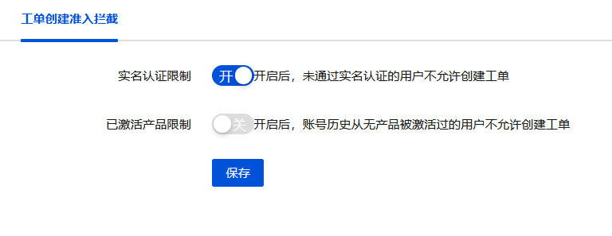

# furuiorg_ticket_gate

魔方业务（V10）工单创建准入拦截插件。

## 简介

对未实名认证、或账号历史从未有过已激活产品的用户，禁止其创建工单（工单功能由官方插件 `idcsmart_ticket` 提供）。

## 拦截规则

满足以下**全部**条件时才允许创建工单：

1. 已完成实名认证；
2. 账号历史存在状态为 `Active` / `Suspended` / `Deleted` 的产品（即曾激活过产品）。

两项规则均可在插件配置中单独开关，关闭时该不做限制。

## 安装位置

上传插件至/public/plugins/addon并且在后台启用插件，默认实名认证限制开关和已激活产品限制开关都为开启状态

## 问题

若有问题，请提交issues，目前已知问题未子账号可绕过限制，等待进一步修复或者禁用子账号功能

## 配置项

| 配置                                      | 说明               | 默认      |
| ----------------------------------------- | ------------------ | --------- |
| `furuiorg_ticket_gate_certification_open` | 实名认证限制开关   | 1（开启） |
| `furuiorg_ticket_gate_host_open`          | 已激活产品限制开关 | 1（开启） |

## 作者

FuRuiORG、YeHuaiJing
